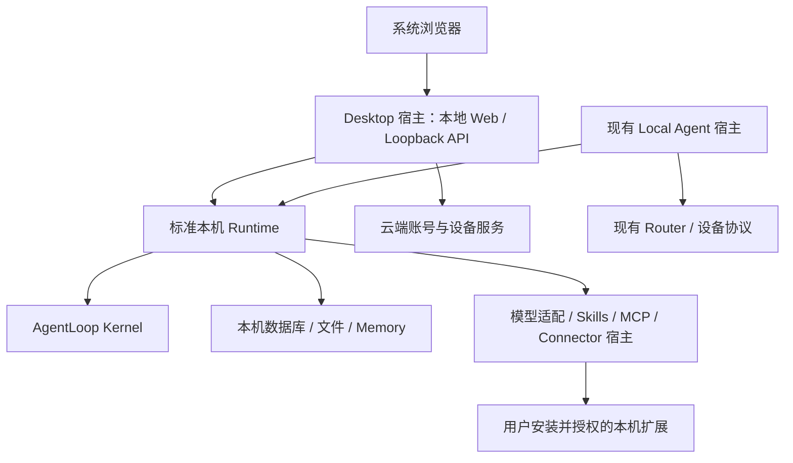

# 标准本机 Runtime 与 Desktop App 设计方案

日期：2026-11-01

状态：阶段 A 已完成三批实现；阶段 B 已落地 Desktop 开发宿主、loopback Web/API、本机业务闭环及本机模型配置，前端按 Multi Runtime 现有展示效果实现。验证记录见第 10～14 节；真实模型、账号授权与发行尚未完成。

实现分支：`feature/desktop-app`，从本地 `main` 的 `3037260350b37cca89c255b42cfd9ce6f573efc7` 创建。

## 1. 目标与核心决策

抽出标准化的本机 Runtime，使 Desktop App 与现有 Local Agent 共同使用同一套本机执行、配置和持久化实现。Runtime 可以独立于 Router、Runtime Host、设备配对和云端调度启动；宿主通过公开端口提供身份、秘密存储、模型适配和系统集成。

本次确定以下边界：

- `packages/agentloop` 继续承担通用 Kernel 的规划、执行和证据语义。
- 新增 `packages/agentloop-local-runtime`，承担本机 Runtime 的装配、生命周期、持久化和本机能力管理。
- 新增 `apps/agentloop-desktop`，承担桌面启动、本地 Web/API、云端认证、OS 集成及发行。
- 现有 `apps/agentloop-multi-runtime/local-agent-runtime` 逐步收敛为 Local Agent 宿主，保留 Router 协议与设备接入适配。
- 两个宿主复用公共包，不复制执行链，不通过相对路径引用另一 App 的内部实现。
- Desktop 的业务数据默认保存在本机；云端账号服务只负责身份、授权及必要的设备治理。

本文中的“标准”指仓库内稳定的公共契约与一致行为。首期只标准化已存在的本机需求，不提前设计通用分布式调度框架。

## 2. 当前基线与需要拆开的边界

以创建分支时的本地 `main` 为准：

| 已有能力 | 位置与现状 | 本次处理 |
| --- | --- | --- |
| Kernel、RunService、SkillService、SQLite | `packages/agentloop` | 复用公开 API |
| 本机 Runtime Factory、Supervisor、配置与目录授权 | `apps/agentloop-multi-runtime/local-agent-runtime/src` | 按职责抽入公共包 |
| 本机 Memory 插件与结算 | `packages/agentloop-memory` 及 Local Runtime 装配 | 保持可选，抽离对宿主设备状态的直接读取 |
| Connector SDK 与具体平台包 | `packages/connector-sdk`、`packages/connector-*` | 复用协议，平台包继续独立装载 |
| Connector Registry、Loader、RuntimeService | `apps/agentloop-multi-runtime/src/connectors` | 抽出可复用宿主实现，消除跨 App 内部引用 |
| Router 账号、租户、设备与会话 | `apps/agentloop-multi-runtime/src/router/identity`、`devices` | 可作为云端身份服务的演进基础 |
| 原生应用 OAuth 授权码、PKCE 与刷新协议 | 当前身份实现尚未提供本方案所需的完整契约 | 先定义 CloudAuthPort，再补真实服务适配 |
| 本机凭据加密 | Local Agent 文件型 AES-GCM，主密钥位于本机文件 | 保留兼容适配，Desktop 正式版接 OS 密钥存储 |

当前 `main` 已合入 Connector 分支的已提交内容。因此新分支继承这些提交，不需要再次整体合并 Connector 分支，也不复制其他工作区的未提交改动。

第一个需要调整的边界位于本机装配层：`LocalRuntimeFactory` 同时依赖 `LocalAgentOptions`、设备状态、云端模型代理以及 Multi Runtime 内部配置/Connector 模块。现有 `LocalAgentService.authorize` 还向 Router 查询本机会话。公共 Runtime 应接收宿主提供的端口和可信上下文，具体云端协议留在宿主。

## 3. 目标依赖关系



静态依赖方向为 `App → 本机 Runtime → Kernel / 公共协议包`。公共包不得导入 `apps/*`。Router 客户端、云端模型代理及 OAuth 协议通过宿主适配器接入。

Desktop UI 只访问本机业务 API；登录时在系统浏览器访问云端认证页面。现有 Local Agent 宿主继续履行已有 Router 协议，不因共享公共 Runtime 自动改变其联网行为。

## 4. 代码与职责边界

建议目标目录如下；具体子目录可在抽取时按实际内聚性调整。

```text
packages/agentloop-local-runtime/
├── src/
│   ├── index.ts                 # 显式公共导出
│   ├── contracts/               # 可信身份、Runtime DTO、宿主端口
│   ├── service/                 # Factory、Supervisor、会话与 Run 用例
│   ├── configuration/           # 模型、Skill、MCP、Connector 配置
│   ├── persistence/             # SQLite、目录授权、秘密引用
│   ├── connectors/              # Loader、Registry、按 Run 物化工具
│   └── memory/                  # 可选 Memory 集成与结算编排
└── tests/

apps/agentloop-desktop/
├── src/
│   ├── main.ts                  # 组合根与启动编排
│   ├── auth/                    # CloudAuthPort、PKCE、刷新
│   ├── api/                     # Loopback HTTP 与事件传输适配
│   ├── runtime/                 # 公共 Runtime 的 Desktop 装配适配
│   ├── platform/                # 浏览器、目录选择、单实例、数据路径
│   └── security/                # 本地 Session、CSRF、OS SecretStore
├── web/                         # 本地页面、客户端、样式
└── tests/

apps/agentloop-multi-runtime/local-agent-runtime/
└── src/                         # 现有 Agent HTTP / Router / 设备适配
```

Desktop 的 `runtime/` 只允许做参数映射和依赖注入。本机数据库布局、Run 用例、Connector 装载和恢复逻辑归公共包，避免再次出现第二套实现。

Connector 宿主实现首期放入本机 Runtime 公共包的独立模块；若现有云端 Host 仍需使用该实现，则通过公开子路径复用。只有出现独立演进需求时，才进一步拆成单独的 Connector Host 包。

### 4.1 公共契约

公共 API 使用明确导出和不可变 DTO，不向宿主暴露可随意改写的数据库连接或内部 Supervisor 对象。下表规定语义，TypeScript 签名在第一阶段落实。

迁移期间额外提供显式 `./host` 入口，包含已抽取的 Supervisor、配置存储及其低层控制对象；该入口属于受信宿主兼容层。新的应用业务入口使用根模块的封装接口，不接触数据库和 RunService。实现迁入公共包不等于宿主接口已完成收敛；统一管理接口完成前仍保留该兼容边界。

| 契约 | 责任 |
| --- | --- |
| Runtime 生命周期 | 创建、列举、启动、停止、drain、重启、关闭；明确配置变更与活动 Run 的冲突规则 |
| 业务用例 | Conversation、Run 启动/取消/查询、按序号读取事件、上传源、Artifact 查询与读取 |
| ExecutionContext | 宿主验证后提供 owner 与必要作用域；禁止从浏览器请求体直接采信身份字段 |
| LocalIdentityPort | 提供稳定本机安装标识及所有者作用域，替代公共包直接读取配对文件 |
| SecretStorePort | 写入、读取、轮换与删除秘密；持久化配置只保存秘密引用 |
| ModelProviderPort | 显式模型目录与适配器解析；默认无需 Router，云端代理由宿主注入 |
| 系统集成端口 | 目录选择、数据路径和结构化脱敏诊断；由宿主提供平台实现 |
| Memory 配置 | 显式启用、稳定本机作用域、结算模型与生命周期；沿用现有语义 |

HTTP Session、Cookie、OAuth token 和 Router dispatch envelope 都不进入公共 Runtime 的核心业务接口。浏览器与 Router 的请求由各自宿主完成验证、授权和映射；公共 Runtime 继续校验资源归属、Connection 授权及目录 scope。

事件以持久化序号为准，Desktop 的 SSE 或其他传输只是适配。断线后从最后确认序号重读，不依靠内存流恢复事实。

### 4.2 必须保持的执行语义

- Kernel 的 Plan、Run、Evidence、结果与恢复契约保持唯一来源。
- Runtime 的 Skill/MCP 绑定、目录授权、模型显式选择和生命周期冲突规则沿用已有行为。
- Connector 的发现不等于授权；运行前按所有者、Runtime、Connection 和权限校验。
- Connector 显式选择 `[]` 表示禁用，不能回退为默认全部启用。
- Memory 继续本机保存并按 owner 隔离；启用、事实提交、结算失败和禁用行为保持可观察，不生成虚假成功状态。
- 崩溃后的 Run 依据 Kernel 现有恢复机制判定，不把所有未完成 Run 直接视为成功或无条件重放外部副作用。

## 5. 数据与身份边界

| 内容 | 云端账号服务 | 本机 |
| --- | --- | --- |
| 注册、密码校验、账号资料 | 负责 | 不接收或保存账号密码；可缓存展示资料 |
| OAuth 授权、Token 签发与撤销 | 负责 | 换码、刷新；access token 优先内存保存，refresh token 进入 OS SecretStore |
| Conversation、Plan、Run、Evidence、事件 | Desktop 模式不接收 | 本机持久化 |
| 文件、附件、Artifacts、Memory | Desktop 模式不接收 | 本机持久化 |
| 模型、Skill、MCP、Connector 配置 | 默认不接收 | 本机配置和执行 |
| Connector Token、Cookie、密钥与路径 | 不接触 | OS SecretStore 与本机授权范围内使用 |
| 设备登记 | 仅必要的设备身份与版本信息 | 设备私钥与本机安装状态 |

“本机保存”不表示所有处理都离线：远程模型会接收推理所需内容，远程 MCP、搜索和 Connector 也会发生外部网络请求。产品必须明确数据发送对象，区分 AgentLoop 云端账号服务与用户选择的模型/工具服务。本机执行不默认启用云端模型代理。

标准 Runtime 本身不要求云端登录。Desktop 首期产品策略为：正常使用要求完成登录；可用本机会话内不逐请求访问云端，刷新失败时保留本地数据并提示重新登录。过期后不接纳新 Run，已接纳 Run 不因账号服务短时不可达被直接中断；保留同一所有者的只读查询与导出，直至显式退出。跨重启离线授权、订阅与长期宽限策略另行定义，不默认为永久离线授权。

本机资源按可信身份映射到稳定的本机 owner。换账号、退出和设备撤销不会自动合并所有者数据，也不会删除本机历史；失效 Session 不得读取其他 owner 的数据。恢复登录后只能回到对应 owner 的空间。

Desktop 与已安装 Local Agent 首期使用不同应用数据目录、进程锁和服务端口。公共 Runtime 是共享代码，不代表两个宿主同时打开同一组可写数据库。历史数据迁移需要单独设计备份、版本检查和所有权映射，首期不自动接管现有安装目录。

## 6. Desktop 启动、认证与本地服务

1. 确定 OS 应用数据目录，获取单实例锁；再次启动应打开已有实例页面。
2. 先绑定 `127.0.0.1` 的空闲端口，准备本机 Session 机制，再初始化 Runtime；就绪检查通过后开放业务操作。
3. 同一个服务提供静态 Web、业务 API 和事件流；自动打开系统默认浏览器，Chrome 可作为用户选择。
4. 未登录时，由本机创建 OAuth attempt，保存随机 `state`、PKCE verifier、过期时间与回调绑定，再打开云端授权页。
5. 云端按原生公共客户端的 PKCE 协议回调 loopback 地址。本机只接收一次性 authorization code，验证 attempt 后由服务端换取 Token。
6. 验证可信身份，将 refresh token 写入 OS SecretStore，为浏览器建立独立的随机 HttpOnly Session；回调随后跳转到不含 code 的本地页面。
7. 后续业务请求与数据流都走本机。退出时使本地 Session 失效，删除刷新凭据，并尽力调用云端撤销接口；本地退出不能依赖撤销接口成功。

`CloudAuthPort` 至少覆盖授权 URL 生成、换码、刷新、可信身份解析、退出撤销和错误分类。生产授权端点与 issuer 必须由受信配置确定；若采用 OIDC，则验证 issuer、audience、签名与 nonce。公共客户端不携带可被当成服务端秘密的内置 client secret。

Fake Auth 仅存在于测试与显式开发配置，不发真实云端凭据，不作为云端联调通过的证据；正式发行配置不能静默回退到 Fake Auth。

### 6.1 Loopback 安全契约

- 仅监听 loopback，严格验证 Host、Origin 与所有修改状态请求的 CSRF 防护；CORS 不代替请求授权。
- Cookie 使用 HttpOnly、SameSite=Strict、host-only 与明确有效期。HTTP loopback 的 Secure Cookie 行为需在目标浏览器实测，不假定生产 HTTPS 配置可直接照搬。
- Cookie 不按端口隔离。不能以随机端口作为身份凭证；避免 Cookie 名冲突，并要求当前实例的 CSRF token 与可信 Origin 共同约束写操作。
- OAuth 回调是受限例外：以服务端保存的 state/PKCE attempt 校验，不要求已有 Strict Cookie 或普通 API 的 Origin；成功、失败或超时后均终结 attempt。
- OAuth attempt、Session、一次性授权码和刷新操作具备过期与并发控制；刷新轮换原子保存，旧 attempt 不得重放。
- Web 使用本地资源与明确 CSP；不加载第三方脚本。Artifact/上传 HTML 使用隔离预览，不能在带业务权限的同源上下文执行任意脚本。
- Token 不进入 URL、localStorage、日志、事件、导出或业务响应；错误诊断脱敏。

Loopback 防护针对浏览器跨站调用等威胁，不把同一 OS 用户下的恶意进程视为已被完整沙箱隔离。Desktop 正式凭据保护使用 macOS Keychain / Windows Credential Manager 或 DPAPI 等平台适配；现有文件加密适配不宣称具备相同保护等级。

## 7. Connector 接入策略

Connector 模块由本机配置发现和加载，具体平台包不静态列入 Desktop 或 Multi Runtime 应用的业务依赖。Connector SDK、通用宿主和具体 Connector bundle 分离；安装器可以分发独立 bundle，安装并不等于启用或授权。

首阶段只接 Fake Connector 与只读流程，但公共 Runtime 抽取必须保持现有 Connector 行为兼容。Desktop 不默认继承或启用现有 Feishu、126 Mail、WPS 凭据和连接。

首期只接受显式批准的本机插件目录，校验 manifest、SDK 兼容版本、模块标识与内容哈希；拒绝缺失、漂移或未经批准的模块。当前任意 `modulePath` 动态 import 只保留为显式开发能力，不能作为正式安装协议。

受信插件可先采用现有进程内执行，但必须明确它拥有宿主进程权限。对任意第三方插件的强目录/网络隔离需要进程沙箱，不能仅凭 manifest 或只读标签宣称已经实现。签名分发与隔离执行在开放第三方安装前验收。

只读限制在工具物化与调用入口双重校验；测试应证明写操作不能被发现或执行。对声明不实的恶意插件，能力标签本身不构成安全隔离。

云端账号服务默认不接收 Connector 清单。若未来需要设备诊断或能力摘要，先定义最小字段与用户授权，禁止 Token、Cookie、密钥、本机路径和文档内容进入该摘要。

第三方 Connector OAuth 与 AgentLoop 账号 OAuth 分别设计。不同提供商可能要求固定回调或 confidential client；不得为实现个人用户授权而在安装包中预埋可复用服务端秘密。真实接入前验证提供商支持的授权链路，不能把 Fake 流程或手工 Token 当正式授权验收。

## 8. 分阶段实施与验收

每个阶段产出独立、可回归的改动。抽取优先保持行为，再增加 Desktop 能力。

### A. 抽出标准本机 Runtime

先记录现有 Factory、Supervisor、配置、目录、Memory、Connector 与测试依赖，形成逐文件迁移表；把云端模型代理、Router 连接、设备注册与 HTTP Session 留在宿主。公共包从最小端口和组合根开始，逐步迁移既有实现；不通过复制全部目录形成第二套实现。

验收条件：

- 新公共包仅使用公开包依赖，没有 `apps/*` 内部导入；Desktop 不引用 Multi Runtime 内部目录。
- 无 Router URL、无设备配对、无云端 token 的测试宿主能够初始化并运行 Kernel。
- 原 Local Agent 通过公共包完成相同用例，原有端点、数据库、配置和 Router 协议通过回归。
- 本机运行、取消、事件重读、Artifact 读取、目录越权拒绝、所有者隔离、Connector 显式空选择与配置恢复保持一致。
- Memory 禁用不产生额外数据库/worker；启用时 owner 隔离、提交与结算行为保持原契约。
- 迁移不自动修改现有安装数据，不依赖未提交配置和本机秘密才能运行测试。

阶段 A 的首个实现批次仅完成公共契约、最小组合根与旧宿主接入验证。后续批次迁移 Supervisor/配置、Connector 和 Memory，避免一次大搬迁失去可验证基线。

### B. Desktop 本机业务闭环

建立启动器、同源 Web/API 与默认浏览器打开。使用测试宿主身份与受控模型完成“创建 Conversation → 上传 → Run → 事件 → Artifact → 关闭/重启后读取”。开发身份必须显式标记，正式发行不可启用。

验收包括二次启动、端口占用、初始化失败、关闭回收、事件续读与持久化恢复。测试模型只证明基础设施；选定真实模型的端到端 Run 单独记录结果，不与结构测试混称。

### C. Fake Auth 与本地 Session

落实 CloudAuthPort、登录状态机、本机 Session 和 SecretStore 测试适配。覆盖回调重放、state 不匹配、过期、并发刷新、轮换保存失败、跨站写入、退出以及账号切换隔离。

验收明确区分 Fake 服务验证与真实云端授权。目标 Chrome/Edge 等浏览器下实测 loopback Cookie、回调与 CSRF 行为。

### D. 真实云端账号接入

核实并定义现有 Router IdentityService 到原生 OAuth 服务的演进边界，再实现授权、PKCE、刷新、身份与撤销适配。云端服务变更作为单独交付，不在公共 Runtime 内写入云端协议。

验收需要真实注册/登录、刷新轮换、退出、设备失效、离线失败行为与 owner 稳定映射。未经实际支持的协议不通过适配器伪造。

### E. Connector 与能力设置

接入本机 Skill、模型、MCP、Connector 设置，使用 Fake Connector 验证批准安装、配置、授权、只读执行与卸载。再逐个接真实 Connector，分别完成授权和读取验收，不一次性启用所有现有平台。

### F. macOS / Windows 发行

前期即明确应用数据路径、Runtime 工具依赖、平台 SecretStore 和进程管理约束；安装包制作放在本阶段。完成签名、公证或平台发行验证、升级与回滚策略，以及保留用户数据的卸载行为。

最终验收必须包含实际安装、启动、登录、真实模型 Run、Artifact、重启、升级及退出。构建成功或 healthz 正常不能替代这些验收。自动增量更新不属于首期实现前提。

## 9. 变更控制与交付记录

- 实现从本地 `main` 建立独立工作树，不在已有脏工作区切分支，也不 stash、清理或搬入其他任务改动。
- `feature/desktop-app` 为本次明确指定的实现分支；不因创建分支而推送、合并或部署。
- 原 `agentloop-app` 保持独立，本次不替换其认证和前端。现有 Local Agent 仅进行共享 Runtime 接入所需改动。
- 每批记录实际迁移文件、公共 API、兼容变化、验证结果与剩余限制。阶段完成后更新本文状态，不预先标记验收通过。
- 正式数据迁移、真实云端部署、第三方 OAuth 应用发布和安装发行分别形成可审查交付，不混入包抽取的完成定义。

相关文档：

- [本机 Runtime Skill 与 MCP 配置](LOCAL-RUNTIME-SKILL-MCP-CONFIGURATION-DESIGN.md)
- [本机 Connector 配置](LOCAL-CONNECTOR-CONFIGURATION.md)
- [Connector 架构](CONNECTOR-ARCHITECTURE.md)
- [Connector Runtime 集成](CONNECTOR-RUNTIME-INTEGRATION.md)
- [用户 Memory 设计](USER-MEMORY-DESIGN.md)
- [可恢复 Runtime 设计](RECOVERABLE-RUNTIME-DESIGN.md)

## 10. 阶段 A 首批实施记录（2026-11-01）

### 10.1 本批文件迁移

以下源路径均相对于 `apps/agentloop-multi-runtime`，目标路径相对于 `packages/agentloop-local-runtime`。原入口保留适配或重导出，执行逻辑只有一份。

| 原位置 | 公共包位置 / 宿主保留部分 |
| --- | --- |
| `local-agent-runtime/src/service/local-runtime-factory.ts` | 本机装配进入 `src/service/local-runtime-factory.ts`；云端模型代理、部署配置解析与设备身份适配留在原宿主 |
| `local-agent-runtime/src/persistence/directory-scope-store.ts` | `src/persistence/directory-scope-store.ts` |
| `local-agent-runtime/src/persistence/model-stream-capture-store.ts` | `src/persistence/model-stream-capture-store.ts` |
| `local-agent-runtime/src/persistence/local-memory-settlement-reader.ts` | `src/memory/local-memory-settlement-reader.ts` |
| `local-agent-runtime/src/persistence/local-memory-runtime-database-registry.ts` | 替换为 `src/memory/local-runtime-database-registry.ts` 的宿主实例级 Registry，移除旧进程全局实现 |
| `src/connectors/` 的 Loader、Registry、Resolver、RuntimeService 与环境适配 | `src/connectors/`，原目录重导出公开 Connector 入口 |
| `local-agent-runtime/src/service/runtime-supervisor.ts` 的控制类型与错误类型 | `src/contracts/host.ts`；Supervisor 本身暂留旧宿主 |

新增根接口 `createLocalRuntime`，提供 Conversation、Run、取消、序号事件、附件、Artifact 和目录授权用例，隐藏数据库和 RunService。身份与模型通过端口注入，无需 Router URL、注册文件或云端凭据即可运行真实 Kernel。

本批同时补齐初始化任意步骤失败后的资源回收，保持旧数据库和 Memory 命名空间；关闭本机 Runtime 时拒绝仍在接纳或执行的任务。构建、锁文件、原宿主打包脚本和 Docker 依赖顺序已接入新包，尚未执行实际安装包或镜像发行。

### 10.2 验证与已知基线

公共包按严格 TypeScript 配置构建。独立测试采用受控模型与真实 Kernel/SQLite，断言本机 Run 成功、事件和附件跨实例读取、所有者隔离、目录撤权、初始化失败清理、Memory 身份端口及关闭行为；这不代表真实模型或 Desktop 安装验收。

回归保留现有断言，未跳过或放宽失败测试。以下问题在未修改的本地 `main` 上复跑确认同样失败：

- `local-model-save.test.ts`：现有 Responses 请求未携带测试预期的 temperature。
- `local-runtime-supervisor.test.ts`：旧 Web 已包含 `localAgentRouterPath`，与现有源码断言冲突。
- `local-runtime-terminal-log.test.ts`：成功路径 fixture 缺少 Kernel 已要求的 `memoryAction`。
- `multi-runtime.test.ts`：Router 的既有模型类型导入与架构断言冲突。

`agentloop-multi-runtime` 整体 typecheck 的 13 条诊断也与未修改 `main` 一致；没有把整体 typecheck 或全套回归标记为通过。新公共包单独构建及其测试结果以实际命令输出为准。

本批验证汇总：

| 检查 | 结果 |
| --- | --- |
| 公共 Runtime 构建、严格 typecheck | 通过 |
| 公共 Runtime 独立测试 | 9/9 通过 |
| Connector SDK | 8/8 通过 |
| Memory | 61/61 通过 |
| 旧宿主 Factory / Supervisor / 模型 / 配置等专项回归 | 49 通过，3 项上述基线失败 |
| Connector / Memory 配置 / 产物 / Router 连接专项回归 | 19/19 通过 |
| 原有 Multi Runtime 架构契约 | 10 通过，1 项上述基线失败 |
| Local Agent 入口 esbuild 内存 bundle | 通过，确认包含公共 Runtime；没有生成安装包或启动已安装服务 |

以上测试使用本机临时数据，不涉及生产部署或真实凭据。

### 10.3 下一批

继续迁移 Supervisor 与本机配置存储，收敛 `./host` 兼容入口；将幂等接纳、容量、恢复和生命周期统一到公共业务接口。然后进入阶段 B 的 Desktop 启动器、本地 Web/API 与浏览器闭环。真实账号授权、OS 密钥存储、插件安装和平台发行仍按原阶段分别验收。

## 11. 阶段 A 第二批实施记录（2026-11-01）

### 11.1 Supervisor 与配置的单一实现

以下源路径相对于 `apps/agentloop-multi-runtime/local-agent-runtime/src`，目标路径相对于 `packages/agentloop-local-runtime/src`。旧模块保留原有名称的显式重导出，不保留第二份实现。

| 原位置 | 公共包位置 |
| --- | --- |
| `service/runtime-supervisor.ts` | `service/runtime-supervisor.ts` |
| `persistence/local-runtime-configuration-store.ts` | `configuration/local-runtime-configuration-store.ts` |
| `persistence/local-model-configuration-store.ts` | `configuration/local-model-configuration-store.ts` |
| `persistence/encrypted-local-runtime-secret-store.ts` | `persistence/encrypted-local-runtime-secret-store.ts` |

已抽取的范围包括多 Runtime 定义与生命周期、接纳容量、持久化操作记录、Skill/MCP 绑定与凭据引用、Memory 设备配置、模型快照及原有 AES-GCM 文件格式。Resolved 配置类型复用公共契约，原宿主无需改变数据格式、默认 Runtime 身份或端点。

Connector 配置存储及具体平台 OAuth、Skill 安装/元数据服务、目录选择器、Router 和设备状态仍留在 App。本批不将这些宿主能力错误地包装成已经完成的 Desktop 功能。

### 11.2 同时修复的生命周期边界

根因位于 Supervisor 的异步边界，而非模型或 HTTP 响应处理：原 `admitRun` 只检查 ready 缓存，没有检查已占有的 Runtime 变更锁；原直接 reload 没有设备级互斥，回滚成功时又只恢复缓存、未修复数据库状态。

本批调整：

- 新接纳在进入回调前检查 Runtime 变更锁，避免停止、重启、删除尚在等待数据库时接收新任务。
- 创建与重命名也参与生命周期互斥，不与设备重配置交叉写入。
- 直接 reload 自动取得设备级锁；已有配置事务通过专属异步上下文复用自己的锁，保留“应用配置 → 重载 → 失败回滚 → 再重载”的现有流程。其他调用者不能因为锁已存在而绕过互斥。
- reload 成功后把实际状态写回数据库，使持久化列表与广告缓存保持一致；失败仍明确记录 failed，不转换成伪成功。

使用相同的临时 SQLite 探针，在未修改 `main` 与实现分支上分别复现：

| 行为 | 未修改 `main` | 本批实现 |
| --- | --- | --- |
| stop 首次异步等待期间是否进入新接纳回调 | 是 | 否 |
| 重载失败后恢复成功：数据库状态 | failed | ready |
| 同次恢复后的广告缓存状态 | ready | ready |

没有放宽断言、跳过失败路径，或通过重放外部动作掩盖恢复失败。

### 11.3 验证与剩余工作

共享包严格构建/typecheck 通过，独立测试增加到 18 项并全部通过。其中真实 Kernel 集成验证了 Supervisor/Factory 的无 Router 执行、Runtime 数据库隔离、所有者隔离、事件与输出重开读取；使用控制对象的生命周期测试验证锁、容量占位、失败释放、配置回滚、凭据恢复及持久化 drain/stop。

| 本批检查 | 结果 |
| --- | --- |
| 公共包构建 / 严格 typecheck | 通过 |
| 公共包独立测试 | 18/18 通过 |
| 旧宿主 12 组 Runtime、模型、配置、Connector 专项回归 | 64 通过，3 项第 10.2 节已确认的基线失败 |
| 旧宿主整体 typecheck | 13 条诊断，与未修改 `main` 逐条一致 |
| Local Agent ESM / CJS 入口内存 bundle | 均构建成功，确认包含共享 Supervisor 与配置实现；CJS 的 esbuild require.resolve 警告在 `main` 同样存在 |
| 源码依赖方向 / diff 空白检查 | 无 App 内部导入；检查通过 |

这次专项回归的 3 项基线失败分别为 Responses temperature、Web 旧源码断言、缺少 `memoryAction` 的 terminal-log fixture。没有将宿主完整回归或整体 typecheck 标为通过，也没有生成、签名或安装任何发行包。

回归命令从仓库根目录执行；旧测试中的部署配置路径以仓库根目录为基准。公共包测试则可通过 workspace 脚本执行。测试使用临时文件和受控模型，不涉及现有安装数据或生产服务。

本批尚未把低层 Supervisor 暴露为新的业务 API。其 `close()` 保持旧宿主拆除语义，宿主仍负责 Run 结算通知和关闭协调；不能把它等同于根 facade 的受保护关闭。下一批先统一公开的管理/接纳/关闭接口及持久化幂等账本，减少宿主自行操作 RunService；随后进入 Desktop Web/API 与启动器。OS Keychain、真实账号、批准插件安装、安装包及真实模型验收仍未完成。

凭据组合根继续保持模型 vault 与 MCP/Connector vault 分离。若未来共用 vault，必须提供全部所有者的存活引用后才能清理孤儿凭据，不能默认由某一配置存储拥有全部秘密。

## 12. 阶段 A 第三批实施记录（2026-11-02）

### 12.1 公开管理接口与旧宿主接入

根入口新增 `createLocalRuntimeManager`，统一 Runtime 列表、创建、重命名、配置、启动、停止、drain、重启、删除与关闭；`runtime(id)` 返回 Conversation/Run/事件/附件/Artifact/目录业务视图。内部数据库、RunService、Supervisor 与接纳协调器不作为公开句柄，持有资源的字段使用 JavaScript 私有字段。

管理器每次业务调用解析当前控制对象，保留的视图可跨 restart 使用，不会继续引用已关闭数据库。异步业务读写占有生命周期 lease；停止可进入 draining，但等待 lease 释放后才关闭资源。读取不增加 activeRunCount，也不消耗 Run 容量。

`LocalAgentService` 的 strict-local 入口和 `RouterRuntimeControlClient` 的 dispatch 入口改用同一共享接纳实现，保留各自传输协议及旧 dispatch key。新账本绑定和旧 `local_runtime_dispatches` 行在一个事务内提交；旧账本仍可重读，不要求当前模型仍在目录中。两类入口继续使用原宿主显式云端代理模型校验，根 facade/manager 则只接受本机配置的模型目录，没有隐式云端代理。

公开 API 使用示例见 [公共包 README](../packages/agentloop-local-runtime/README.md)。管理操作与目录授权仍由宿主认证；不能直接把管理器无鉴权地映射为 HTTP 路由。

### 12.2 幂等接纳与事务边界

新增 `LocalRunAdmissionService` 和本机 `local_run_admissions` 表。`requestId` 在 Runtime + owner 范围内标识一次逻辑请求，客户端应在首次发送前持久化该 ID，并在重试时复用。省略时生成新 ID，不对独立调用去重。

| 状态 | 行为 |
| --- | --- |
| 相同 ID、相同输入，含并发调用与重开读取 | 返回原 Run，不增加一次容量占用 |
| 相同 ID、不同业务输入 | `request_id_payload_conflict`；未选择 Connector 与显式 `[]` 仍不同 |
| Run 绑定写入失败且事务确认回滚 | Run、上传源绑定及 Run 目录绑定一起回滚；释放该次预约，可安全重试 |
| 已提交绑定、返回响应丢失 | 查询已绑定 Run，不能再创建第二个 Run |
| 重启发现尚未绑定的预约 | `admission_outcome_unknown`，不自动重放或按时间删除预约 |
| 已持久化的 running Run | 保留活动占位，不按十分钟等年龄阈值释放；需显式恢复或取消 |
| 对话已删除 | 事务内保留墓碑；原请求返回 `admission_run_deleted`（410），不再次执行 |
| 账本引用的 Run 意外缺失、没有墓碑 | 明确 `admission_run_missing` 完整性错误，不静默忽略 |

第一个需要修复的边界是“Kernel 已提交并可能开始执行，宿主才另写 dispatch 账本”。单纯在宿主增加内存 Map 无法消除提交后丢响应或进程退出的窗口。

因此 Kernel 只增加中性的受信 `RunStartPersistence` 钩子：在创建 Run、来源绑定及 Run 目录绑定的同一个数据库事务内调用，在通知和模型执行之前完成；异常回滚该事务。它是 `startConversation` 的独立受信参数，不进入 JSON execute options，也不包含 Router/Desktop 协议。回调只能使用同一数据库，禁止网络、文件操作和外部副作用。

对话删除的墓碑由本机账本的 SQLite trigger 随 Run 删除一起提交，删除回滚时墓碑也回滚；Kernel 不增加 Desktop 表或删除策略。旧版本机接纳表的新增列有事务内迁移，不把历史缺失 Run 猜测为合法删除。

以上保证是 **Run 接纳幂等**，不是任意 Connector、文件或远程工具副作用的 exactly-once。未知外部执行结果必须继续遵守 Kernel 的恢复契约，不能为了完成重试而自动再执行。

### 12.3 关闭、取消与恢复

Kernel 增加进程内执行存活查询和 `whenRunIdle`，用于区分“数据库 status 已取消”与“执行协程已退出”。共享接纳协调器在执行真正退出后刷新账本和活动集合，通知 Supervisor 完成 drain；旧宿主的结算通知也不能提前移除仍在执行的 Run。

根 facade 和新 manager 关闭时拒绝正在进行的业务调用或活动执行；执行已结束后先完成账本结算，再关闭资源。manager 的关闭预检失败后仍可继续查询/取消；若已经开始拆除且部分失败，则保持 fail-closed，不让业务继续使用半关闭实例。旧低层 `Supervisor.close()` 仍为受信宿主拆除语义，不据此宣称具有新 manager 的保护。

重启不等于恢复执行：未完成 Run 仍保留原身份与活动占位，不自动再次调用模型。已停止 Runtime 的历史查询尚未由 manager 业务视图提供；旧宿主的独立 Artifact 读取通路仍由宿主负责。

### 12.4 本批验证与下一步

| 检查 | 结果 |
| --- | --- |
| 公共包构建 / 严格 typecheck | 通过 |
| 公共包独立测试 | 29/29 通过 |
| Kernel 配置的 kernel 回归集 | 255/255 通过 |
| 旧宿主 12 组专项 + Router 连接专项 | 共 67 项：64 通过、3 项既有基线失败 |
| 旧宿主整体 typecheck | 13 条诊断，与未修改 `main` 完全一致 |
| Local Agent ESM / CJS 内存 bundle | 均成功，包含共享 Supervisor、配置和接纳服务；CJS 保留既有 esbuild require.resolve 警告 |

新增测试采用真实 Kernel、临时 SQLite 和确定性模型，覆盖 owner/Runtime 隔离、保留视图重启、并发同请求、不同请求独立回滚、真实 SQLite 触发的写入失败及来源绑定回滚、提交后人为模拟丢响应、旧 dispatch 兼容、删除事务回滚/墓碑、异步读取 lease、取消但协程尚未退出，以及受保护关闭。

未绑定预约和一小时前 running Run 的恢复测试使用持久化状态 fixture；它们不是实际进程 kill 或真实工具崩溃验收。没有使用真实模型、第三方凭据、已有安装目录或生产服务。上述 3 项宿主失败仍为第 10.2 节已确认的 temperature、Web 源码断言和 terminal-log fixture，不放宽或跳过。

下一批进入阶段 B：新增 `apps/agentloop-desktop` 启动器、独立数据目录与单实例保护、loopback 同源 Web/API、浏览器打开及本机业务闭环。当前公共 manager **尚不获取跨进程数据锁**；宿主不能同时打开同一可写目录。Connector 配置迁移、批准插件安装、CloudAuthPort/Fake Auth/真实账号、OS Keychain、macOS/Windows 打包与真实模型验收仍未完成。

本批代码继续保留在 `feature/desktop-app` 工作树，未自动提交、推送、部署或安装。

## 13. Desktop 第一批实现与界面方向（2026-11-02）

### 13.1 宿主与展示边界

新增 `apps/agentloop-desktop`，仅通过共享 Runtime 根 manager 调用业务，不依赖其受信 `./host` 子路径，也不引用 Multi Runtime/Local Agent 内部代码。独立目录先取得跨进程排他锁，再装配 Runtime，固定开发 owner 与默认 Runtime；第二进程仅验证实例身份并打开已有页面。

按最新产品要求，Desktop 前端直接仿照 Multi Runtime：复用玄武图标、蓝色主题、侧栏/会话、消息布局、底部输入框和按需产物面板。静态展示样式以本地快照保存；Desktop 自己适配本机 API，不加载另一 App 的 JS、Router 地址或配对协议。未接入功能不伪装成可用设置。当前回复仍按纯文本安全展示，完整 Markdown、执行卡片、Human Loop、内联预览留待后续接入。

### 13.2 本机 HTTP 与安全

- 只监听 IPv4 loopback，随机端口，allowlist 静态文件；Host/Origin/Fetch Metadata、JSON 写入、HttpOnly Session 与 CSRF 联合校验，无 CORS。
- 提供模型目录、历史、Run 创建/重读/取消、事件游标、上传源与产物下载；所有 owner、危险工具策略和 Connector 范围由宿主决定，不信任浏览器传入值。
- `requestId` 首次发送前持久化到当前标签页的 sessionStorage；同源刷新后重试不重复接纳。重启换端口后的跨 origin 草稿恢复未实现。
- 事件每 500ms 轮询而非 SSE，诊断视图限制最近 200 条，不裁剪持久化历史。附件单个 ≤ 1 MiB；产物只下载，不执行同源活动内容。
- 活动请求/Run 阻止关闭，取消状态不代表执行 unwind 已结束。未知/损坏/遗留锁不自动删除，避免双写；数据损坏不替换原文件。

### 13.3 开发身份不是账号服务

本批要求显式 `--development`，使用固定受信开发身份和 `/api/dev/session`。它不是设计中的 CloudAuthPort/Fake Auth，更不是云端账号登录。普通 loopback HTTP cookie 未设 Secure，目标 Chrome/Edge 矩阵需后续验收；不声称抵御同用户恶意本机进程。

模型目录默认空；可用专用本机进程环境变量接入一个 OpenAI-compatible 模型并显式选择，无假模型/云端代理回退。真实远程推理会向所选模型服务传输内容。尚未实现模型配置界面、凭据持久化、云端 PKCE/Token 刷新、Connector 设置及发行流程。

### 13.4 本批验证

- Desktop build、包含测试的严格 typecheck 通过；Desktop 14/14，公共 Runtime 29/29 通过。
- 真实临时 SQLite + Kernel + 确定性模型完成 HTTP 执行、重试、重启读取、来源绑定与事件游标验证；双真实进程验证仅一个数据库所有者。
- 覆盖损坏数据库/绑定端口失败的资源回收、非空外来目录拒绝、未知锁保留、取消但协程未退出的关闭保护及 Session/CSRF 边界。
- 产物下载使用显式持久化文件/工具回执 fixture，不等于模型生成产物验收。本批没有修改 Kernel，未把前批既有宿主失败报告成通过。
- 浏览器验证新界面的任务发送、完成、刷新后历史恢复、附件选择/保存与快捷发送、产物/事件面板和约 390 CSS 像素下的会话抽屉/无横向溢出；使用临时目录与确定性模型，不是云端账号/真实模型/安装包验收。启动器目前打开系统默认浏览器，指定 Chrome 的策略仍待实现。

启动与限制详见 [Desktop README](../apps/agentloop-desktop/README.md)。下一步按账号服务契约实现 CloudAuthPort 与 PKCE，以及本机模型配置/秘密存储；不直接复用旧 SQLite 登录，不扩大到生产或已安装 Agent 目录。

## 14. Desktop 本机模型配置（2026-11-02）

本批优先打通“界面配置 → 公共 Runtime → HTTP 模型适配器 → Kernel Run”，不另造 Desktop 模型注册表或执行链。第 13 节描述的是上一批状态，本节为当前增量。

### 14.1 公共配置契约

- 根 manager 新增 `modelConfiguration()` / `configureModels(input, expectedRevision)`；返回公开配置、revision、editable 与 credentialCleanupPending，不返回 API Key、secret 引用或底层数据库句柄。
- 模型配置仍由共享 `LocalModelConfigurationStore` 存入 Supervisor SQLite，模型凭据通过独立 `modelSecrets` 端口存放。Factory 动态读取已发布配置，不重建 Runtime，也不改变已有 Run 的 endpoint/key。
- 写入排队并校验 revision，拒绝旧标签页覆盖；在设备级重配置锁内执行，活动 Run、接纳和业务 lease 阻止修改。根 API 禁止 `reuseCloudModels:true`，旧宿主明确的云端模型策略不变。
- SQLite 写入失败保留旧配置/目录并清理未提交凭据。新配置提交后旧凭据清理失败则返回告警，不回滚到可能已删除的旧凭据。告警仅在当前进程保留，尚无自动清理/恢复工具。
- 既有模型端口/环境变量注入明确优先，页面只读，不让用户保存看似成功但实际被忽略的配置。

### 14.2 Desktop 交互与安全

新增受 Session 保护的 `GET /api/model-configuration` 与同时校验精确 Origin、JSON、Session、CSRF 的 `POST /api/model-configuration`。首批 Desktop 对服务地址额外要求 HTTPS 或 HTTP loopback，禁止 userinfo/query/fragment；后按用户网关需求调整为第 14.4 节的 HTTP/HTTPS 策略。共享层继续保留旧宿主已有 HTTP 能力，不改变其兼容契约。

设置沿用 Multi Runtime 视觉，提供 Provider/模型 JSON 编辑、独立 API Key 密码框、格式化、删除、保存/放弃重读、未保存关闭保护和冲突提示。模型参数由共享 registry 校验。API Key 不进入 JSON 编辑器、URL、浏览器存储或错误回显；保存确认后立即清空输入，读回只显示是否已有凭据。相同 Provider ID 与规范地址留空可保留旧 key，改地址必须重新填写。

凭据使用独立 `private/model-secrets` AES-256-GCM vault，主密钥为同目录受限权限文件，**不是 Keychain/DPAPI**；不能保护同用户恶意程序或完整目录被盗。主密钥丢失不生成新密钥覆盖旧密文。保存仅验证结构/持久化，不调用服务，也不显示虚假的“连接成功”。远程模型推理内容仍会发送到用户选择的服务。

### 14.3 验证与未完成项

| 检查 | 结果 |
| --- | --- |
| 公共 Runtime 测试 | 37/37 通过 |
| Desktop 测试（含 HTTP 配置与执行） | 16/16 通过 |
| 旧宿主模型配置、Connector 凭据、应用配置专项 | 19/19 通过（包含 3 个 endpoint 子测试） |
| 公共 Runtime / Desktop 构建与严格 typecheck | 均通过；Desktop 包含测试的类型检查 |
| Web JS 语法、依赖边界与 diff 空白检查 | 通过；Desktop 不导入其他 App 或受信 host 子路径 |

新增集成覆盖真实 loopback HTTP 的 Responses/Chat Completions 适配器、Kernel Run、重开与凭据保留、明文测试 key 泄露扫描、过期版本/活动任务拒绝、真实 SQLite 触发写入失败、缺失主密钥及删除后抛异常的凭据清理失败。不弱化协议校验，不把测试夹具当真实模型。

浏览器使用全新临时目录和本机 HTTP 协议夹具，完成保存、密码框清空、脱敏重读、留空 key 保留、错误参数继续编辑、未保存关闭保护及任务完成；默认桌面和约 388 CSS 像素窄屏验证标题/关闭可达、内容可滚动且无横向溢出。测试不使用现有安装数据或第三方真实凭据。

下一步应由用户在本机页面填写真实服务与凭据，验收真实模型的协议、工具调用、取消及重启后配置恢复；不要把 API Key 发到聊天。真实模型尚未验收，不能据此声称完成生产可用性。CloudAuthPort/PKCE、OS Keychain/DPAPI、Connector 设置与批准加载、完整 Markdown/执行轨迹/内联产物、SSE、指定 Chrome 启动和 macOS/Windows 打包仍分批实现。本批不提交、推送、部署或安装。

### 14.4 HTTP 模型网关兼容（2026-11-02）

用户要求支持 `http://aigw.baocloud.cn/v1`。边界差异来自 Desktop 设置 API 与环境变量入口额外拒绝了非 loopback HTTP，并非共享模型适配器不支持 HTTP。

两处入口统一使用模型出站 URL 校验：支持 HTTP/HTTPS 域名、局域网和 loopback 地址，不设单域名特例；仍拒绝 URL userinfo、query、fragment 和非 HTTP 协议。设置帮助和错误文案明确 HTTP 明文传输 API Key/推理内容，可能被中间人读取或篡改，应优先使用 HTTPS、HTTP 仅用于可信网络。Desktop 自身仍仅监听 `127.0.0.1`，不放宽入站 Host/Origin/Session/CSRF，不关闭 TLS 校验或把 HTTPS 自动降级。

Desktop 回归增至 18/18：新增统一 URL 策略及公共设置 API 的外部 HTTP 配置、模型目录与重启保留测试；测试使用合成凭据，显式阻止对外 fetch，配置保存不探测远程网关。尚未向该真实网关发送凭据或模型请求，不能据此宣称真实模型验收完成。

## 15. Desktop 对话流细节对齐 Multi Runtime（2026-11-02）

首个信息丢失边界在 Desktop 前端：本机已经持久化流式、计划与工具事件，但页面只呈现 `run.output`。本批补齐公共 Run/事件 DTO → 每轮投影 → 回复卡片，不修改 Kernel 成功条件，不引入 Router 或伪进度。

- 直接对齐 Multi Runtime 的用户气泡、回复 live-card、来源、模型、终态、计划折叠、思考区、工具轨迹、事件序号、复制和时间信息。纯展示函数保留显式快照并测试逐字一致，Desktop 只适配公共本机 DTO。
- 每轮独立游标，完整历史事件重放；重复事件去重，流正文按累计值替换而非拼接。Run 终态读取后补读尾部事件，避免事件/状态两次读之间的提交竞态。只有诊断面板截取最近 200 条，计划/工具投影不受其影响。
- 原位更新变化的卡片，旧 Markdown 不重复解析；保持每轮折叠、文本选择与独立滚动。阅读历史时不拉回底部；输入三行增高、Enter 换行、非输入法组合态的 Cmd/Ctrl+Enter 发送。HTTP 未确认只呈现待确认提交，不宣称创建 Run。
- 完成正文使用 Multi Runtime 同一个共享安全 GFM renderer；流式正文继续转义展示，完成后切换 Markdown。原始 HTML 与危险协议被拒绝/转义，CSP 不放开外部图片。最终/阶段产物分组下载，完成后的阶段产物默认折叠，不执行同源活动 HTML。
- 失败总结单列为尚非成功交付；取消不保留执行动画，不把未完成工具/计划视为成功。待用户输入只说明 Desktop 响应能力尚未接入，不伪造确认按钮或继续执行。

本批 Desktop 27/27、共享 Runtime 37/37、共享产物/Markdown 10/10，Desktop build/typecheck 通过。浏览器使用临时独立目录和确定性流式模型，通过真实 Kernel 验证流式卡片、终态 Markdown、折叠、两轮历史重放、复制、快捷发送和上翻阅读位置保持；不是第三方真实模型/账号/安装包验收。当前仍为 500ms 轮询，不是 SSE。Human Loop/恢复响应、内联预览、OS Keychain、Connector 设置、PKCE 与打包仍未完成，不因界面相似而宣称已接入。

## 16. Connector 与 Desktop 统一主目录集成（2026-11-02）

开发和启动统一在 `/Users/zhujun/coding/agentloop` 的 `main`。先分别完成分支测试及本地提交，再依次合并；不推送远端、不部署或安装，也不删除原工作树和用户未跟踪配置、归档文件。

- Connector 分支提交：`22d11da`；与 main 的合并提交：`b004a00`。
- Desktop 分支提交：`46be084`，包含标准本机 Runtime、独立 Desktop 宿主与旧 Local Agent 适配。
- 冲突按能力边界合并：保留 main 的 Memory、供应商扩展参数和共享重连；保留 Connector 的作用域化能力清单；保留 Desktop 的原子 Run 绑定与取消后 execution-idle 生命周期。
- MCP 配置显示名与配置清单投影随实现迁入 `packages/agentloop-local-runtime`，旧路径只做转发。新增真实共享 Factory → Kernel → 模型上下文 → 持久化事件回归，证明清单保留且不授予工具调用权限，不泄露服务标识、地址、凭据或输入 schema。

主目录合并后验证：

| 验证项 | 结果 |
| --- | --- |
| Kernel unit / integration | 204/204、260/260 |
| Memory | 61/61 |
| 共享 Local Runtime / Desktop | 38/38、27/27 |
| 共享产物与 Markdown | 10/10 |
| Connector SDK / 126 Mail | 8/8、21/21 |
| Provider、能力清单、重连与 Connector 定向交叉回归 | 124/124 |
| Kernel、Memory、SDK、Local Runtime、Desktop 构建 | 通过；Connector 三个实现也已构建通过 |
| Local Runtime、Desktop 严格类型检查 | 通过；新增能力清单测试另行严格检查通过 |
| 旧 Multi Runtime 全量（从仓库根运行） | 397/410；13 个失败均在合并前 main 的 14 个失败集合中，无新增失败 |
| 旧 Multi Runtime 类型检查 | 仍有原 main 的相同 13 条诊断，无新增 |

旧宿主首次全量遇到一次临时目录清理 `ENOTEMPTY`，独立复测 4/4 与完整复跑均通过；不以此修改业务实现或放宽验收。全量遗留失败与类型诊断仍需单独处理，不能称仓库全绿。测试使用确定性模型、合成凭据和临时本机服务，不代表真实网关、云账号或安装包已验收。

当前依赖及构建产物已在主目录准备好，可执行 `npm run start:desktop -- --development`。全新检出应先安装依赖，并按共享包依赖顺序构建 Kernel、Memory、Skills、Connector SDK、Artifact Preview、Local Runtime 和 Desktop；源码所在目录与 Desktop 独立用户数据目录是不同边界，不应把旧 Local Agent 数据直接搬入 Desktop。
